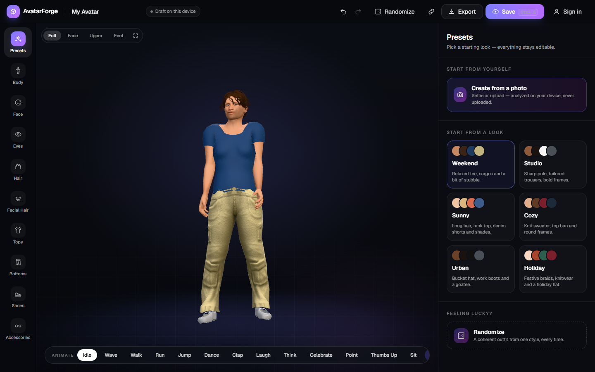
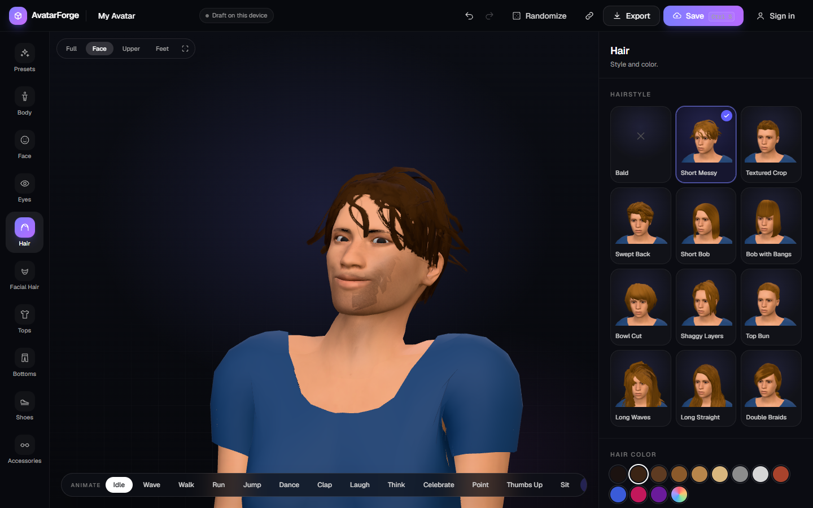
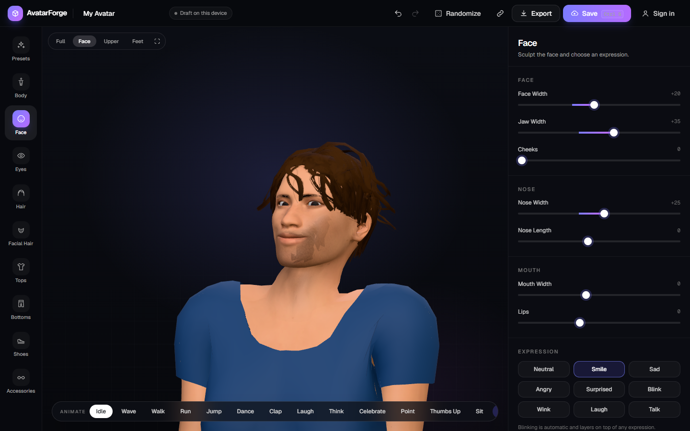
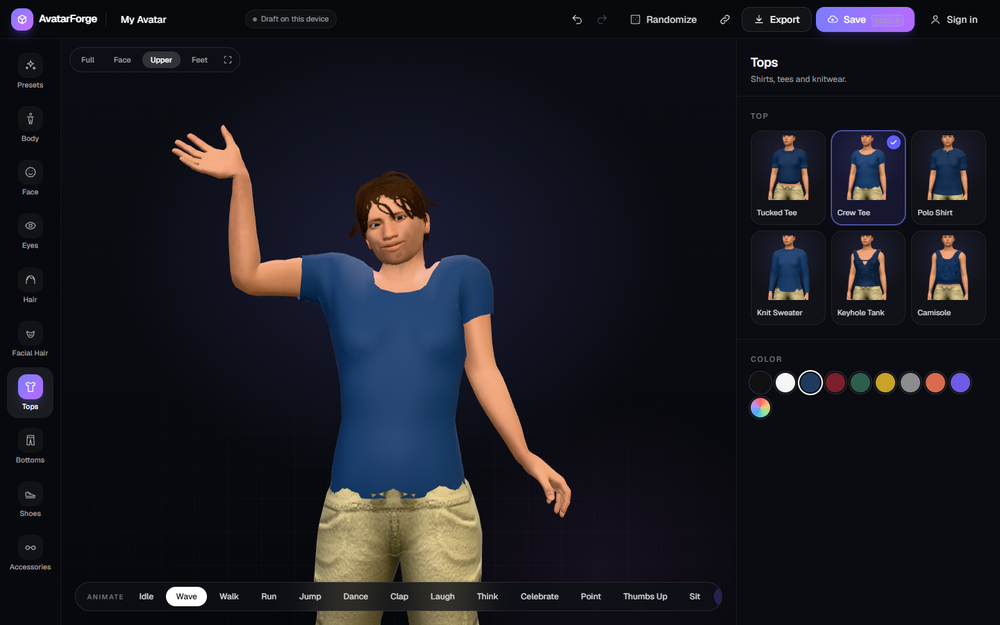
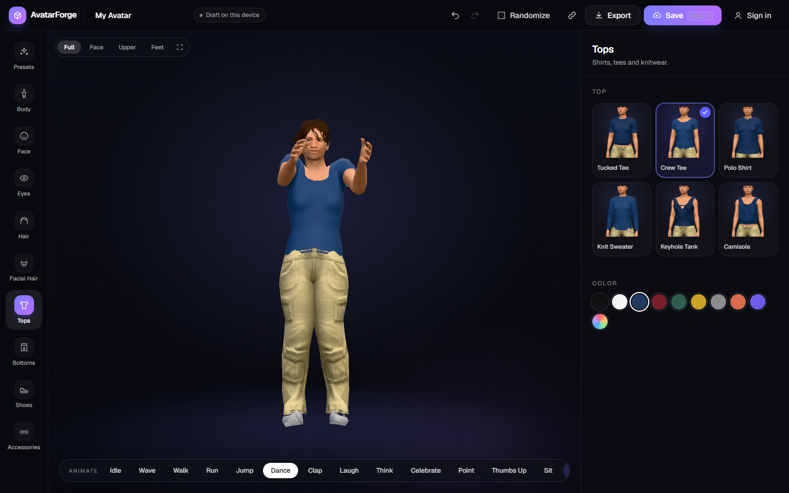
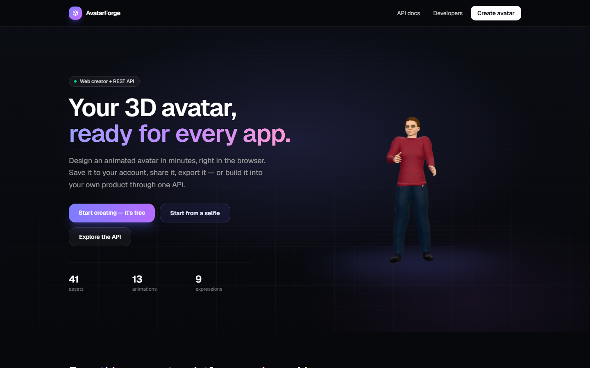
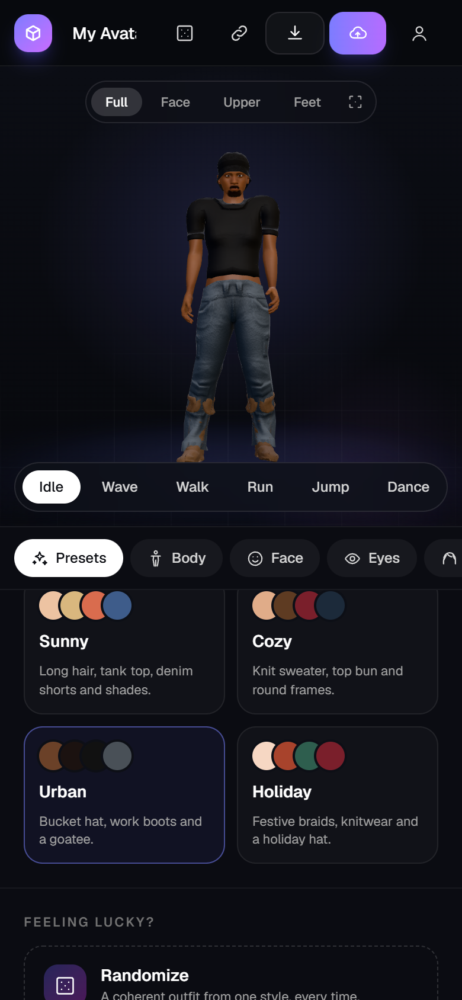
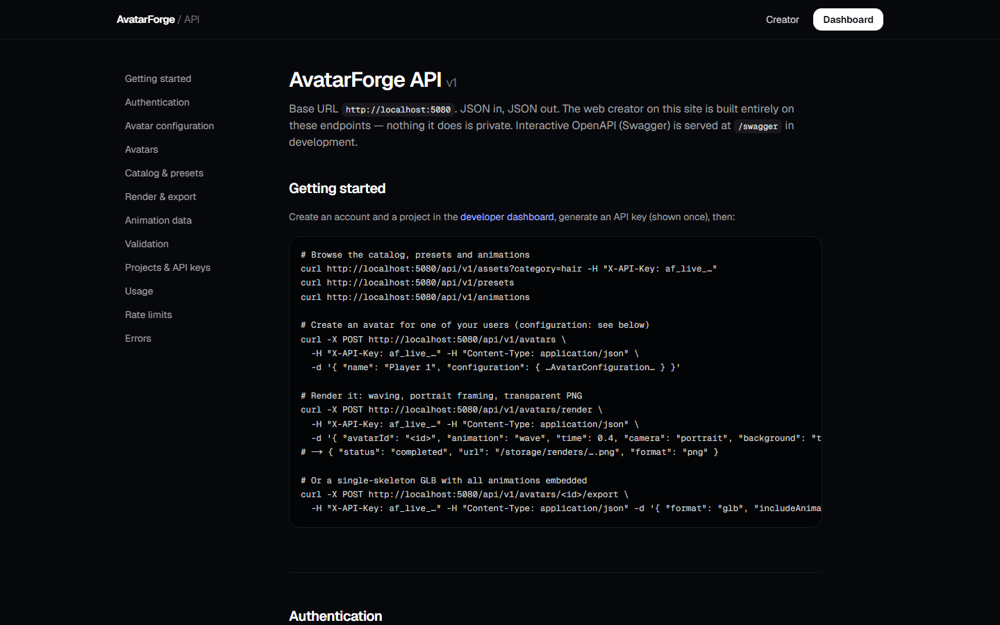
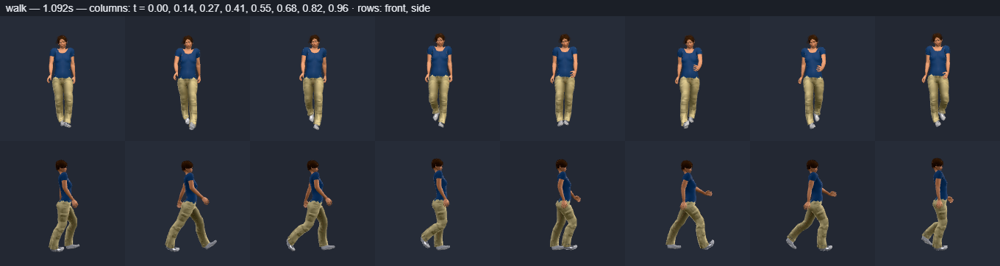
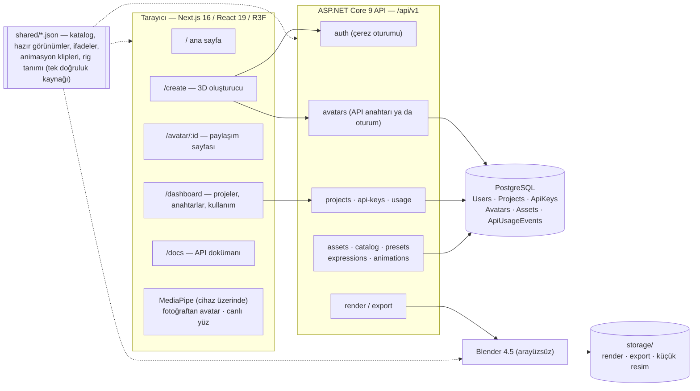

<div align="center">

# AvatarForge

**3D avatar platformu: tarayıcıda çalışan bir avatar oluşturucu ve onu besleyen REST API.**

Kullanıcılar web sitesinde avatarlarını tasarlar, hareket ettirir, kaydeder, paylaşır ve dışa aktarır.
Geliştiriciler aynı avatarları kendi uygulamalarından bir API anahtarıyla oluşturur, saklar ve render
alır. Web oluşturucu da API'nin sıradan bir istemcisidir.




</div>

---

## İçindekiler

- [Ekran görüntüleri](#ekran-görüntüleri)
- [Neler çalışıyor](#neler-çalışıyor)
- [Mimari](#mimari)
- [Hızlı başlangıç](#hızlı-başlangıç)
- [Yapılandırma ve gizli bilgiler](#yapılandırma-ve-gizli-bilgiler)
- [Testler ve kontroller](#testler-ve-kontroller)
- [Güvenlik](#güvenlik)
- [Eksikler ve yol haritası](#eksikler-ve-yol-haritası)
- [Klasör yapısı](#klasör-yapısı)
- [Dokümantasyon](#dokümantasyon)
- [İçerik lisansları](#içerik-lisansları)

## Ekran görüntüleri

Tüm ekran görüntüleri çalışan uygulamadan alınmıştır (Chromium, yazılımsal WebGL). Hiçbiri mockup değildir.

| Saç — 11 model, istenen her renk | Yüz şekillendirme ve ifadeler |
|---|---|
|  |  |
| **Animasyon — El sallama** | **Animasyon — Dans** |
|  |  |

| Ana sayfa | Mobil oluşturucu | API dokümanı (`/docs`) |
|---|---|---|
|  |  |  |

<details>
<summary><b>Animasyon kalite kontrol tablosu</b> (yürüme döngüsü; önden, yandan ve çapraz)</summary>

Gerçek görüntüleyiciden `tools/asset-pipeline/qa_animation_sheets.mjs` ile üretilir. Dirsek ve
dizlerin yalnızca eklemlerin büküldüğü yöne büküldüğünü ve ayakların yerde kaldığını kontrol etmek
için kullanılır.



</details>

## Neler çalışıyor

- **Oluşturucu** (`/create`): gerçek zamanlı 3D avatar; fare ve dokunmatikle döndürme, yakınlaştırma
  ve kaydırma; kategoriye göre kamera kadrajları; yüz şekillendirme (9 çift yönlü morph kaydırıcı);
  otomatik göz kırpmalı 9 ifade; ten rengi, göz rengi; vücut tipi, boy, omuz ve bacak uzunluğu;
  11 saç modeli, 7 sakal ve bıyık modeli, 6 üst, 4 alt, 4 ayakkabı, 3 şapka, 6 gözlük. Renk
  verilebilen her parça istenen renge boyanabilir. Ayrıca 6 hazır görünüm, stil uyumlu rastgele
  avatar, geri al / yinele ve yumuşak geçişli 13 animasyon var.
- **Fotoğraftan avatar**: selfie çek ya da fotoğraf yükle. Ten rengi, göz rengi, saç uzunluğu, saç
  rengi, kâkül, sakal, bıyık ve yüz oranları **cihazın üzerinde** ölçülür (MediaPipe, kendi
  sunucumuzdan sunulur, fotoğraf hiçbir yere yüklenmez). Sonuçlar onaya sunulur ve tek seferde geri
  alınabilir bir değişiklik olarak uygulanır.
- **Canlı yüz**: kamerayı açtığında avatar ifadelerini (52 ARKit blendshape) ve baş hareketlerini
  gerçek zamanlı taklit eder. Bu da tamamen cihaz üzerinde çalışır. Kamera kapalıyken avatar seninle
  göz teması kurar ve doğal biçimde etrafına bakınır.
- **Hesaplar ve kayıt**: editörden çıkmadan giriş yapılır. **Kaydet** avatarı API üzerinden hesabına,
  bir portre küçük resmiyle birlikte kaydeder. **Avatarlarım** galerisi ve doğrudan bağlantılar
  (`/create?avatarId=…`) var. Taslaklar yerelde otomatik kaydedilir, yani giriş yapmadan yapılan iş
  de kaybolmaz.
- **Paylaşım**: avatarı herkese açık yaptığında herkesin görüntüleyebileceği (animasyonlu) ve kendi
  versiyonunu çıkarabileceği bir `/avatar/{id}` sayfası oluşur.
- **Dışa aktarma**: PNG (512–2048 px; şeffaf ya da değil; tam boy, portre ya da mevcut görünüm), tek
  iskelet + tüm animasyonlar + ARKit yüz blendshape'leriyle GLB, yapılandırma JSON'u içe/dışa aktarma.
  Bunlara ek olarak API'nin Blender hattıyla sunucu tarafında HD PNG / GLB.
- **API ve geliştirici paneli**: sürümlü REST uçları (`/api/v1`), projeler, API anahtarları (yalnızca
  bir kez gösterilir, hash'lenerek saklanır), proje bazlı sahiplik, istek sınırlama, kullanım takibi
  ve sunucu tarafı doğrulama. Ayrıntılar `/docs` sayfasında ve
  [`docs/api-platform.md`](docs/api-platform.md) dosyasında.

## Mimari



Avatar, hazır bir model olarak değil, küçük bir **yapılandırma JSON'u** olarak saklanır (vücut, yüz,
saç, sakal, kıyafet, aksesuar, renkler). Web görüntüleyici, API'nin doğrulayıcısı ve Blender
render'ı aynı avatarı bu yapılandırma ve ortak katalog üzerinden yeniden oluşturur.

## Hızlı başlangıç

Gereksinimler: **Node 22+**, **.NET 9 SDK**, **PostgreSQL 14+** (geliştirme makinesinde WSL Ubuntu
içinde çalışıyor), **Blender 4.5 LTS** (yalnızca sunucu tarafı render/export için), Pillow kurulu
Python 3 (yalnızca asset hattı için).

```powershell
npm install
copy .env.example .env        # ardından veritabanı bağlantı bilgilerini doldur (aşağıya bak)
powershell -ExecutionPolicy Bypass -File scripts/dev.ps1   # Postgres + API (:5080) + web (:3000)
```

Ya da adım adım:

```powershell
wsl -d Ubuntu -u root -- service postgresql start
npm run assets:server        # bir kez: Blender render'ı için api/server-assets/ klasörünü üretir
npm run api                  # http://localhost:5080  (açılışta migration ve katalog senkronu çalışır)
npm run dev                  # http://localhost:3000  (3000 doluysa Next 3001'i kullanır)
```

Geliştirme ortamındaki Blender yolları ve CORS adresleri
`api/src/AvatarForge.Api/appsettings.Development.json` içindedir. `Blender:*` ayarlarını kendi
makinene göre düzenle.

## Yapılandırma ve gizli bilgiler

**Gizli bilgiler asla repoya girmez.** Hassas olan her şey repo kökündeki, git tarafından yok sayılan
`.env` dosyasında durur. Repoda yalnızca şablon olan [`.env.example`](.env.example) bulunur.

| Değişken | Kim okur | Amaç |
|---|---|---|
| `NEXT_PUBLIC_AVATARFORGE_API_URL` | Next.js (tarayıcı) | Web uygulamasının API'ye ulaştığı adres. Varsayılan `http://localhost:5080`. |
| `ConnectionStrings__Default` | API | PostgreSQL bağlantısı. İstenirse `dotnet user-secrets` içinde de (`ConnectionStrings:Default`) tutulabilir; ortam değişkeni önceliklidir. |
| `AVATARFORGE_TEST_DB_CONNECTION` | Entegrasyon testleri | Ayrı test veritabanı. Bu değişken olmadan testler başlamaz. |
| `API_ALLOWED_ORIGINS` | API (production) | Virgülle ayrılmış CORS adresleri. Tanımlı değilse farklı origin'den gelen istekler reddedilir. |

- Next.js `.env` dosyasını kendisi okur ve tarayıcıya yalnızca `NEXT_PUBLIC_*` değişkenlerini gönderir.
  Bu yüzden gizli bir bilgiyi asla `NEXT_PUBLIC_*` değişkenine koyma.
- `npm run api` ve `npm run test:api`, `.env` dosyasını [`scripts/with-env.mjs`](scripts/with-env.mjs)
  üzerinden yükler (.NET `.env` dosyasını kendiliğinden okumaz).
- API anahtarları panelden oluşturulur ve **yalnızca bir kez** gösterilir. Veritabanında yalnızca
  SHA-256 hash'leri saklanır.

## Testler ve kontroller

```powershell
npm run test:api     # 63 entegrasyon testi: gerçek HTTP + gerçek PostgreSQL + gerçek Blender render'ı
npm run typecheck
npm run lint
npm run build
```

`npm run dev` çalışırken tarayıcı seviyesindeki QA script'leri gerçek görüntüleyiciyi kullanır
(bkz. [`tools/asset-pipeline/README.md`](tools/asset-pipeline/README.md#qa-tools)): animasyon
tabloları, yakın plan görünüm tabloları, fotoğraf analizinin bilinen değerlerle karşılaştırılması,
fotoğraf özelliğinin uçtan uca testi ve editör duman testi (tüm animasyonlar → hesap oluşturma →
kaydetme → yeniden yükleme → sunucu render'ı).

## Güvenlik

Şu an devrede olanlar:

- **Şifreler**: kullanıcı başına salt ile PBKDF2-SHA256. Başarısız girişte hatanın e-postada mı
  şifrede mi olduğu söylenmez.
- **Oturumlar**: HTTP-only, `SameSite=Lax` çerezler. Geliştirme dışındaki ortamlarda her zaman `Secure`.
- **API anahtarları**: yüksek entropili `af_live_…` anahtarlar. Yalnızca SHA-256 hash'leri saklanır,
  iptal edilebilirler ve her anahtarın kendi istek limiti vardır. Panel kimlik doğrulaması ile API
  anahtarı doğrulaması ayrı mekanizmalardır.
- **Yetkilendirme**: proje ve anahtar uçlarının tamamı oturum açmış kullanıcı ister ve yalnızca
  kullanıcının kendi projeleri üzerinde işlem yapar. Avatarlar sahibi olan kullanıcı ya da projeyle
  sınırlıdır. Testlerle doğrulanır (anonim → 401, başka kullanıcı → 403).
- **İstek sınırlama**: API anahtarı başına, oturum açmış hesap başına ve giriş/kayıt denemeleri için
  IP başına (kaba kuvvet saldırılarına karşı).
- **CORS**: adres listesi yapılandırmadan gelir. Yapılandırılmamışsa kapalı kalır.
- **Doğrulama**: avatar yapılandırmaları sunucu tarafında katalogla karşılaştırılarak doğrulanır.
  Blender hattına yalnızca sunucunun çözümlediği dosya yolları verilir.
- **Gizlilik**: fotoğraf analizi ve canlı yüz takibi tamamen tarayıcıda çalışır. Görüntüler hiçbir
  zaman yüklenmez.
- **Gizli bilgiler**: `.env` ya da user-secrets içinde tutulur, asla kodda ya da git'te değil (yukarıya bak).

## Eksikler ve yol haritası

Bu çalışan bir MVP, bitmiş bir ürün değil. Eksik olanların ya da henüz yeterince iyi olmayanların
dürüst listesi:

### Görsel kalite

- **Sakal ve bıyık** katmanlı kabuklarla çiziliyor. Yakından bakınca katmanlar görünüyor ve kısa
  sakal (stubble) yer yer lekeli duruyor (yukarıdaki saç ekran görüntüsünde de fark ediliyor).
- **Saçlar** CC0 topluluk paketlerinden geliyor. Bazı modeller tel tel ya da topak topak görünüyor;
  bazılarında (ör. *Swept*) tel dokusu yok ve tek parça bir kütle gibi duruyor.
- **Kıyafet** modellerinin kenarları belirgin şekilde düşük poligonlu / tırtıklı, bazılarında doku
  bozuklukları var (ör. beyaz polo). Vücut kaydırıcıları yalnızca kemikleri hareket ettiriyor;
  vücut kütlesi morph'ları olmadığı için kıyafetler vücuda yeniden oturtulmuyor.
- **Tek bir temel vücut** var. `face.shape`, `nose`, `mouth`, `earShape` gibi alanlar yalnızca etiket
  olarak saklanıyor; geometri yüz kaydırıcılarından geliyor ve kulak şekli için morph yok.
- **Animasyonlar** prosedürel olarak hazırlanmış, motion capture değil. Yürüme ve koşma yerinde
  oynuyor (root motion yok). Yüz ifadeleri temel düzeyde.

### Platform ve ürün

- **E-posta doğrulama ve şifre sıfırlama yok**, OAuth / sosyal giriş yok.
- **Render senkron çalışıyor** (istek başına 5–15 sn, her istek için ayrı bir Blender süreci). Gerçek
  hacim için bir iş kuyruğu ve sıcak bekleyen bir worker havuzu gerekiyor.
- **İstek sınırlama bellekte tutuluyor.** Tek API sunucusu için doğru çalışıyor; yatayda
  ölçeklemek için Redis (ya da benzeri) gerekiyor. Ters proxy arkasında, IP başına giriş limitinin
  gerçek istemci adresini görmesi için forwarded header'ların açılması gerekiyor.
- Render, export ve küçük resimler için **yerel dosya depolama** kullanılıyor. Henüz S3 / CDN yok.
- **Tarayıcıdan alınan GLB dosyaları sıkıştırılmamış** (tüm kliplerle ~15–20 MB). Sunucu export'u ~10 MB.
- **Panelde** sayfalama, denetim kaydı (audit log) ve ekip hesapları yok. **Faturalandırma** kapsam dışı.
- Ürün vizyonundaki **SDK'lara** (Unity / Unreal / mobil) henüz başlanmadı.
- **Fotoğraftan avatar** yalnızca sentetik render'larla doğrulandı. Alışılmadık ışık, makyaj ya da
  baş örtüsü doğruluğu düşürüyor (her öneri uygulanmadan önce kullanıcı onayına sunuluyor).

### Mühendislik

- **Geliştirme ortamı Windows odaklı** (WSL içinde PostgreSQL, PowerShell script'i,
  `appsettings.Development.json` içinde makineye özel Blender yolları). Henüz Docker Compose yok.
- **CI yok** (GitHub Actions) ve deploy hattı yok. Entegrasyon testleri yerel PostgreSQL ve Blender
  gerektiriyor.
- Model değişikliklerinden sonra `api/server-assets/` klasörünün elle yeniden üretilmesi gerekiyor
  (`npm run assets:server`).
- Kod için henüz **lisans dosyası** seçilmedi.

## Klasör yapısı

| Yol | İçerik |
|---|---|
| `src/app` | Next.js sayfaları: ana sayfa, `/create`, `/avatar/[id]`, `/dashboard`, `/docs` |
| `src/features/avatar` | Oluşturucu: yapılandırma şeması, state (zustand), 3D görüntüleyici (R3F), arayüz panelleri, API servisleri |
| `src/features/photo` | Fotoğraftan avatar ve canlı yüz: cihaz üzerinde analiz (MediaPipe), özellik → yapılandırma eşlemesi |
| `src/features/auth`, `src/features/dashboard` | Oturum ve panel istemcileri |
| `shared/` | Katalog, hazır görünümler, ifadeler, animasyon klipleri, rig tanımı; web, API ve Blender tarafından okunur |
| `api/` | ASP.NET Core çözümü (Domain / Application / Infrastructure / Api) ve entegrasyon testleri |
| `tools/blender-pipeline` | Asset üretimi (MakeHuman/MPFB2) ve API'nin çalışma anında kullandığı `assemble_avatar.py` |
| `tools/asset-pipeline` | Doku hazırlama, GLB son işleme, sakal üretici, animasyon klibi üretici, QA script'leri |
| `public/models`, `public/thumbnails`, `public/textures` | Tarayıcı asset'leri (meshopt ile sıkıştırılmış GLB'ler) |
| `docs/` | Aşama aşama tasarım notları ve doğrulanmış sonuçlar; `docs/images/` README görsellerini içerir |

## Dokümantasyon

Ayrıntılı dokümanlar İngilizcedir:

- [`docs/web-creator.md`](docs/web-creator.md): API üzerine kurulu tarayıcı oluşturucu
- [`docs/avatar-system.md`](docs/avatar-system.md): rig, katmanlar, materyaller, sakal, animasyon, görüntüleyici ↔ Blender uyumu
- [`tools/asset-pipeline/README.md`](tools/asset-pipeline/README.md): asset'lerin nasıl üretildiği ve eklendiği
- [`docs/api-platform.md`](docs/api-platform.md), [`docs/developer-platform.md`](docs/developer-platform.md), [`docs/export-pipeline.md`](docs/export-pipeline.md): API, panel, render hattı
- [`docs/asset-pipeline.md`](docs/asset-pipeline.md), [`docs/performance-baseline.md`](docs/performance-baseline.md): asset lisansları ve performans

## İçerik lisansları

Üçüncü taraf 3D asset'lerin tamamı **CC0** lisanslıdır (MakeHuman topluluk paketleri; lisans her asset
için tek tek doğrulanır ve çıkarma script'i CC0 olmayan hiçbir şeyi kabul etmez). Sakal ve bıyıklar,
bunların dokuları, animasyonlar, arayüz ve kod bu projenin kendi çalışmasıdır. Fotoğraf özelliği
Google'ın MediaPipe Tasks çalışma ortamını ve modellerini (Apache-2.0) kullanır; bunlar
`public/mediapipe/` altından kendi sunucumuzda sunulur. Lisans denetimi için
[`docs/asset-pipeline.md`](docs/asset-pipeline.md) dosyasına bakın.
